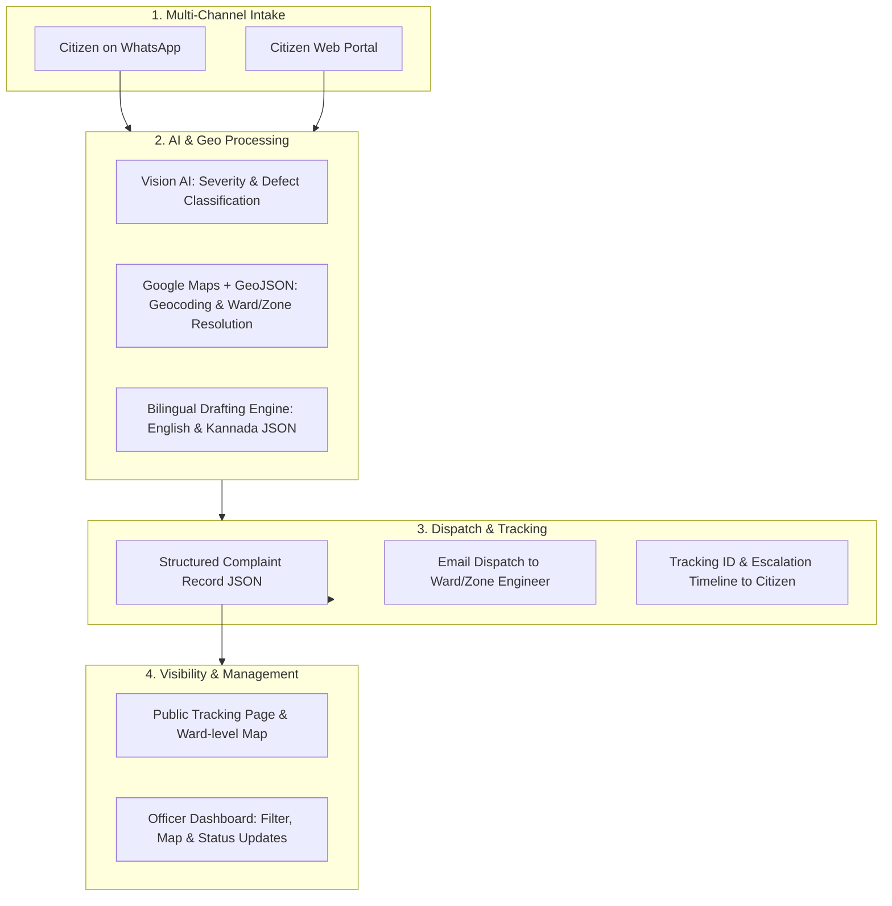

# Problem & Solution Statement: BBMP Pothole Complaint Management System

---

## 1. Executive Summary

Bengaluru faces severe infrastructure challenges, with road surface defects (potholes, cave-ins, and surface erosion) causing traffic bottlenecks, vehicular damage, accidents, and citizen frustration. While municipal administration (Bruhat Bengaluru Mahanagara Palike - BBMP) has designated zones and wards to address these issues, the current reporting and grievance redressal mechanisms suffer from friction, lack of transparency, language barriers, and fragmented tracking.

The **BBMP Pothole Complaint Management System** is an AI-powered, multi-channel reporting and tracking solution designed to bridge the gap between citizens and municipal authorities via conversational interfaces (WhatsApp) and web accessibility.

---

## 2. Problem Statement

### 2.1 Context & Core Challenges
Citizens encounter multiple barriers when attempting to report civic road hazards in Bengaluru:

1. **High Friction & Inaccessible Reporting Channels:**
   - Traditional civic apps often require complex registrations, heavy app downloads, or cumbersome navigation, discouraging immediate on-the-spot reporting.
   - WhatsApp is the ubiquitous messaging platform across all demographic segments in Bengaluru, yet official automated intake via WhatsApp is often nonexistent or unintelligent.

2. **Unstructured & Ambiguous Data Intake:**
   - Reports submitted through conventional social media or hotlines lack standardized metadata (e.g., precise geolocation coordinates, ward/zone mapping, visual proof, and categorized severity).
   - Municipal engineers spend excessive time triaging unstructured complaints and clarifying locations rather than dispatching repair crews.

3. **Linguistic Barriers:**
   - Bengaluru's diverse population requires bilingual communication. Complaints often need to be filed or reviewed in Kannada (the official state language) by ward engineers, while citizens may communicate in English or mixed vernacular.

4. **Lack of Transparency & Accountability:**
   - Citizens rarely receive clear, auditable tracking IDs or structured escalation timelines (Ward Engineer $\rightarrow$ Zonal Joint Commissioner $\rightarrow$ Special/Chief Commissioner).
   - Once reported, grievances often vanish into a "black box" without visible resolution stages or public accountability maps.

5. **Officer Triage Bottlenecks:**
   - Ward officers lack a unified, lightweight interface to view, filter, map, and update real-time progress on reported potholes across their respective jurisdictions.

---

## 3. Proposed Solution

The **BBMP Pothole Complaint Management System** provides an automated, AI-assisted pipeline that ingests citizen reports, standardizes complaint metadata, auto-generates bilingual documentation, and enables transparent status tracking.

### 3.1 Key Solution Components

#### A. Multi-Channel Intake (WhatsApp & Web)
* **WhatsApp Conversational Agent:** Citizens can upload a photo and drop a GPS location pin directly in a WhatsApp chat.
* **Citizen Submission Web Portal:** Provides an interactive map pin-drop, ward auto-detection/selection, photo upload, and instant bilingual draft preview.

#### B. Vision AI & Automated Triaging
* **Visual Hazard Classification:** Identifies road defects (`pothole`, `other_road_damage`, `not_a_road_issue`) and automatically assesses severity on a 3-tier scale (**Low**, **Medium**, **High**) with confidence scoring.
* **Junk/Irrelevant Image Rejection:** Filters out invalid uploads before they burden municipal staff.

#### C. Spatial Resolution & Ward Mapping
* **Reverse Geocoding & Point-in-Polygon Lookup:** Converts GPS coordinates into standard postal addresses and resolves the exact BBMP Ward and Zone using municipal boundaries.
* **Citizen Override:** Allows citizens to verify or manually select their ward if boundaries overlap.

#### D. Bilingual Complaint Drafting (English + Kannada)
* **Standardized JSON Schema:** Builds machine-readable, schema-compliant records containing geo-coordinates, photos, severity, ward, and timestamps.
* **Bilingual Descriptions:** Synthesizes structured English and Kannada narratives for clear administrative communication, flagging machine translations for human review where appropriate.

#### E. Direct Dispatch & Local Escalation Hierarchy
* **Automated Notification:** Dispatches structured complaints to the designated ward/zone mailbox.
* **Structured Escalation Framework:** Generates an auditable escalation path:
  1. **Level 1:** Ward Junior/Assistant Executive Engineer
  2. **Level 2:** Zonal Executive / Joint Commissioner
  3. **Level 3:** BBMP Special Commissioner / Chief Commissioner

#### F. Transparency & Officer Dashboard
* **Public Tracking & Civic Map:** Enables citizens to check complaint status via unguessable Tracking IDs and view anonymized, ward-aggregated defect counts without exposing sensitive personal info.
* **Officer Management Portal:** Gives ward officials a dashboard to review visual evidence, filter by ward/severity, inspect locations on a map, and transition complaint statuses (`drafted` $\rightarrow$ `submitted` $\rightarrow$ `acknowledged` $\rightarrow$ `in_progress` $\rightarrow$ `resolved` / `rejected`).

---

## 4. Value & Impact

| Stakeholder | Key Benefit |
| :--- | :--- |
| **Citizens** | Zero-friction reporting via WhatsApp/Web, instant bilingual confirmation, clear escalation SLAs, and full visibility over resolution progress. |
| **Ward Engineers & Officers** | Pre-triaged, structured complaints with verified coordinates, severity ratings, and photo evidence—eliminating inspection guesswork. |
| **BBMP Administration** | Ward-level aggregated metrics, automated escalation alerts, reduced manual overhead, and heightened civic trust. |
