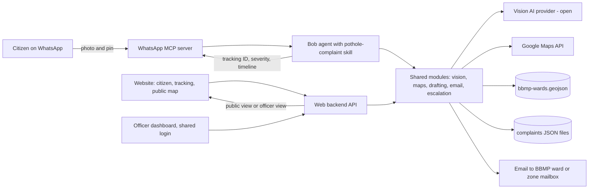
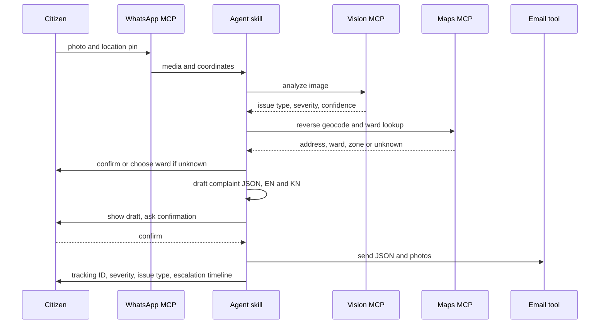

# High-Level Design (HLD) - BBMP Pothole Complaint Agent

Status: v1 implemented for demo and tested with mocks and automated tests only; nothing has been run against live Google, WhatsApp, SMTP or AI services or in a real browser. Items marked **(open)** still need a decision from the user. See [plan.md](plan.md).

## 1. Purpose

A citizen sends a pothole or road-damage photo on WhatsApp or through a website. The agent classifies the issue, resolves the location to a BBMP ward and zone, drafts a complaint in English and Kannada as JSON (with photos and geo tag), emails it to a configured BBMP address, and replies with a tracking ID, severity, issue type and escalation timeline. The website adds a public tracking page, a public complaints map and an officer dashboard.

## 2. Scope

**In scope (v1)**
- WhatsApp and a website as input channels (website added in revision).
- Website: citizen submission page (photo upload, Google Map pin, ward selection, EN/KN draft preview, confirm); tracking page by tracking ID; public map with ward-wise counts; officer dashboard (list, filter, map, status update) behind a single shared login.
- Vision AI classification: issue type and 3-tier severity (Low / Medium / High).
- Google Maps geocoding and BBMP ward/zone resolution, with user override.
- Complaint JSON with English text and LLM-generated Kannada text flagged `needs_human_review`.
- Email dispatch to a configurable ward/zone address.
- Local tracking and escalation timeline (ward engineer, zone, commissioner).

**Out of scope (v1)**
- A database, and per-officer accounts or roles.
- Direct BBMP / Sahaaya API integration (no public API verified).
- Invented SLA values: escalation `days` stay `null` until the user supplies them.
- Real-time status from BBMP.
- Human translation workflow.

## 3. Key Decisions

| Topic | Decision |
|---|---|
| Runtime | Bob skill (`SKILL.md`) plus MCP servers, running in the Bob/IBM agent runtime |
| Channel | WhatsApp and website; both use the same drafting pipeline |
| Storage | JSON files remain the source of truth; the website reads and writes them (demo-grade: no scaling, limited search, concurrent-write risk) |
| Web stack | TypeScript, Node 22, Express 5, static HTML with ES modules (chosen by the implementer, not confirmed with the user) |
| Officer login | One shared username and password from environment variables |
| Submission | Email of complaint JSON to ward/zone address from config |
| Ward lookup | Ward GeoJSON when present; else Google Maps geocode plus user confirmation |
| Severity | Low / Medium / High from vision output |
| Escalation | ward_engineer -> zone -> commissioner; days blank; computed locally |
| Kannada | LLM-generated, always `needs_human_review: true` |

## 4. System Context

## 5. Components

| Component | Responsibility | Status |
|---|---|---|
| `pothole-complaint` skill | Orchestrates the WhatsApp flow, enforces rules (no invented data, confirm before send) | Implemented: `.bob/skills/pothole-complaint/SKILL.md` |
| WhatsApp MCP server | Receive photos and location pins, send replies | Built (`src/mcp/whatsapp.ts`); mock-tested only |
| Vision MCP server | Thin wrapper over shared vision module: issue type, severity, confidence | Built (`src/mcp/vision.ts`); pluggable provider, mock by default |
| Maps and ward MCP server | Thin wrapper over shared maps module: geocode, reverse geocode, ward point-in-polygon, map link | Built (`src/mcp/maps.ts`) |
| Shared modules | Vision, maps, drafting, email, escalation logic used by both MCP servers and the web backend (the web backend cannot call Bob MCP tools) | Built (`src/core/`) |
| Web backend API | Draft, confirm, public lookup, officer list/filter/status update, login, photo upload | Built (`src/web/app.ts`) |
| Citizen submission page | Upload, map pin, ward select, EN/KN preview, confirm | Built (`web/public/index.html`) |
| Tracking page and public map | Lookup by tracking ID; pins and ward counts without private data | Built (`track.html`, `map.html`) |
| Officer dashboard | List, filter, map, status update behind shared login | Built (`officer.html`) |
| Complaint drafting | Build and validate complaint JSON, EN + KN text | Built (`src/core/drafting.ts`, `pipeline.ts`) |
| Email dispatch and tracking | Send email, compute escalation, status lookup | Built (`src/core/email.ts`, `escalation.ts`) |
| Config and schema | `schema/complaint.schema.json`, `config/*.json`, `.env.example` | Done |

## 6. End-to-End Flow

Web flow: the citizen page posts photos and a pin to the backend, which runs the same vision, maps and drafting steps, returns the EN/KN draft for confirmation, then emails and returns the tracking ID and escalation timeline.

## 7. Data

- **Complaint record:** `complaints/<tracking_id>.json`, validated against `schema/complaint.schema.json`.
- **Escalation config:** `config/escalation.json` (levels with `days: null`).
- **Contacts config:** `config/bbmp-contacts.json` (ward -> zone -> default email, placeholders).
- **Ward boundaries:** `data/bbmp-wards.geojson` (source **(open)**).
- **Photos:** stored locally; referenced by file path in the complaint.

## 8. Non-Functional Considerations

- **Privacy:** complaint files contain the reporter's contact and photos. Ignore `.env` and `complaints/*.json` in version control. Public pages (tracking, public map) use a projection with status, severity, issue type, ward, escalation timeline and photos (confirmed public); reporter contact and name are never included.
- **Public photos:** photos can show faces or number plates. Serve public copies with EXIF/GPS stripped and random file names. Face/plate blurring and exact vs coarse pin location on the public map are **(open)**. The citizen page must tell users their photos will be public before they confirm.
- **Tracking ID as access control:** the tracking page is public, so IDs must be random and unguessable.
- **Officer access:** one shared credential means no per-officer audit trail; use HTTPS and rate-limit login attempts.
- **Storage limits:** the dashboard reads all JSON files; writes must be atomic (temp file + rename); not suitable for high volume.
- **Secrets:** API keys only via environment variables (`.env.example`).
- **Correctness of Kannada:** unverified LLM output; flagged for human review in the JSON and shown as such to the user.
- **No fabricated data:** SLA days, emails and ward data come only from config files; blanks are reported as "not configured".
- **Failure handling:** non-road photo or low confidence -> ask for another photo; no location -> ask for a pin or address; no ward match -> ask the user.

## 9. Risks and Open Items

| Item | Impact |
|---|---|
| Real vision provider not confirmed **(open)** | Demo runs on a mock that does no analysis; set `VISION_PROVIDER=openai` to use a real model |
| Ward GeoJSON source and BBMP emails unknown **(open)** | Ward auto-resolution and dispatch cannot work without them |
| WhatsApp access method **(open)** | Business Cloud API needs a business account and a public webhook (to be verified) |
| Email transport **(open)** | Demo writes `.eml` files to `outbox/`; SMTP is untested |
| Hosting **(open)** | Must serve HTTPS and keep `complaints/` on persistent disk. Web stack was chosen by the implementer, not confirmed |
| Status values, pin precision, photo blurring **(open)** | Implemented as proposed defaults: four officer statuses, pins rounded to about 110 m, no blurring |
| Public photos expose bystanders | Mitigated by EXIF strip and user notice; blurring undecided |
| JSON file storage | Demo-grade only; moving to a database later would change `src/core/store.ts` and the callers of `listComplaints` |
| Escalation days blank | Timeline shows "not configured" until supplied |
| Email may not be a recognised BBMP intake channel | Complaint delivery is best-effort; no confirmation from BBMP |
