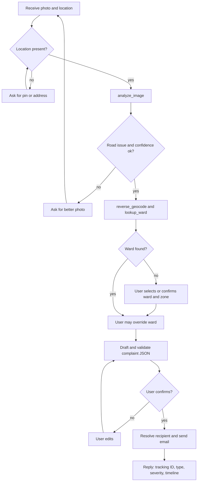

# Low-Level Design (LLD) - BBMP Pothole Complaint Agent

Status: v1 implemented for demo. Sections 1-4 describe the code as built; items still marked **(open)** are undecided. Nothing has been verified against live Google, WhatsApp, SMTP or AI services. See [HLD.md](HLD.md), [plan.md](plan.md) and the root `README.md`.

## 1. Repository Layout

```
.bob/skills/pothole-complaint/SKILL.md   skill (orchestration)
schema/complaint.schema.json             complaint JSON schema
config/escalation.json                   escalation levels, days null
config/bbmp-contacts.json                ward/zone emails, placeholders
data/bbmp-wards.geojson                  ward boundaries (to be supplied)
complaints/                              one JSON per complaint; complaints/photos/ holds stored photos
outbox/                                  demo emails (.eml) when EMAIL_TRANSPORT=outbox
uploads/whatsapp/                        media downloaded from WhatsApp
src/core/                                shared logic: config, store, ids, escalation, contacts, wards, maps,
                                         llm, vision, photos, drafting, email, publicView, pipeline, validate
src/web/                                 Express app, session, rate limiter
src/mcp/                                 MCP servers: vision, maps, complaints, whatsapp
src/whatsapp/                            WhatsApp Cloud API client and webhook helpers
web/public/                              static pages and ES modules
test/                                    vitest suites
.env.example                             env var names
docs/                                    documentation
```

Web stack (decided by the implementer, not confirmed with the user): TypeScript, Node 22, Express 5, static HTML with ES modules.

## 2. Complaint Record (implemented)

Defined in `schema/complaint.schema.json` (JSON Schema 2020-12, `additionalProperties: false`, all top-level fields required).

| Field | Type | Notes |
|---|---|---|
| `tracking_id` | string | `BBMP-` + 10 Crockford base32 characters (50 bits random) |
| `reporter` | `{channel: "whatsapp" or "web", contact: string or null, name?}` | Never public |
| `location` | `{lat, lng, address, ward, zone}` | `address`, `ward`, `zone` nullable until resolved or confirmed |
| `photos` | string[] (1 to 10) | Random `<32 hex>.jpg` names under `complaints/photos/`; EXIF stripped at upload |
| `issue_type` | enum | `pothole`, `other_road_damage`, `not_a_road_issue` (open item) |
| `severity` | enum | `Low`, `Medium`, `High` |
| `text` | `{en, kn}` | `kn` is LLM-generated |
| `needs_human_review` | boolean | Always true while Kannada is LLM-generated |
| `status` | enum | `drafted`, `submitted`, `acknowledged`, `in_progress`, `resolved`, `rejected` (officer values are proposed, not confirmed) |
| `status_history` | `{status, at, note}[]` | Appended on every change; `note` is private to officers |
| `created_at` | date-time | |
| `escalation` | `{level, days, due}[]` | `days` and `due` nullable |

Example (illustrative values only):

```json
{
  "tracking_id": "<format TBD>",
  "reporter": { "channel": "whatsapp", "contact": "<number>", "name": null },
  "location": { "lat": 12.97, "lng": 77.59, "address": "<geocoded>", "ward": null, "zone": null },
  "photos": ["complaints/photos/<tracking_id>-1.jpg"],
  "issue_type": "pothole",
  "severity": "High",
  "text": { "en": "<English complaint>", "kn": "<Kannada complaint>" },
  "needs_human_review": true,
  "status": "drafted",
  "created_at": "2026-01-01T00:00:00Z",
  "escalation": [
    { "level": "ward_engineer", "days": null, "due": null },
    { "level": "zone", "days": null, "due": null },
    { "level": "commissioner", "days": null, "due": null }
  ]
}
```

## 3. Config Files

- `config/escalation.json`: `{ "levels": [ {level, days: null} x3 ] }`, order ward_engineer, zone, commissioner. `days` must be null or a non-negative integer; anything else is a config error.
- `config/bbmp-contacts.json`: `{ "default": {email}, "zones": {<zone>: {email}}, "wards": {<ward>: {zone, email}} }`. Lookup order: ward -> zone -> default. If nothing is configured the complaint is not sent (smtp) or goes to `DEMO_RECIPIENT` (outbox demo mode).
- `.env.example`: every variable is documented in the file. All are optional for a local demo.

## 4. Tool Contracts and API (as built)

Every MCP tool returns JSON text; recoverable failures set `isError` with a plain message (no stack traces). Servers log to stderr only.

### 4.1 `bbmp-vision` (`src/mcp/vision.ts`, logic in `src/core/vision.ts`)

| Tool | Input | Output |
|---|---|---|
| `analyze_image` | `image` (stored photo name or file under `uploads/`) | `{issue_type, severity, confidence, description, provider, acceptable, reject_reason}` |
| `analyze_images` | `images[]` (1-5) | most severe acceptable result |

`acceptable` is false for `not_a_road_issue` or confidence below `VISION_MIN_CONFIDENCE` (default 0.5). `provider: "mock"` does no analysis. Image references outside `uploads/` are refused. Severity rubric (size, depth, traffic risk) is a proposed default in the prompt **(open)**.

### 4.2 `bbmp-maps` (`src/mcp/maps.ts`, logic in `src/core/maps.ts`, `src/core/wards.ts`)

| Tool | Input | Output |
|---|---|---|
| `reverse_geocode` | `lat, lng` | `{address}`; null without a key or result |
| `geocode` | `query` | `{lat, lng, address}` or null; config error without a key |
| `lookup_ward` | `lat, lng` | `{ward, zone, resolved}`; `resolved: false` with nulls when GeoJSON is absent or no match |
| `list_wards` | none | `{wards: [{ward, zone}]}` from GeoJSON, else from contacts config |
| `zone_for_ward` | `ward` | `{zone}` |
| `map_link` | `lat, lng` | `{url}` |

Ward names come from GeoJSON properties; set `WARD_NAME_PROPERTY` / `WARD_ZONE_PROPERTY` for the chosen source **(open)**. A malformed GeoJSON is a config error, never a guess.

### 4.3 `bbmp-whatsapp` (`src/mcp/whatsapp.ts`, `src/whatsapp/client.ts`)

| Tool | Input | Output |
|---|---|---|
| `get_incoming_messages` | optional `since` (ISO) | `{messages: [{id, from, received_at, type, text, media_paths[], location}]}` |
| `send_message` | `to` (digits), `text` | `{ok, message_id}` |
| `send_location` | `to, lat, lng, label?` | `{ok, message_id}` |

The webhook (`GET/POST /webhook`) runs inside this process only when `WHATSAPP_VERIFY_TOKEN` and `WHATSAPP_APP_SECRET` are set. Posts are verified with `X-Hub-Signature-256`; unsigned posts get 403. The queue is in memory (max 200, de-duplicated by message id). Not tested against a real account.

### 4.4 `bbmp-complaints` (`src/mcp/complaints.ts`, logic in `src/core/pipeline.ts`)

| Tool | Purpose |
|---|---|
| `create_draft_complaint` | vision -> reverse geocode -> ward -> EN/KN text -> validate -> save as `drafted`; never emails |
| `confirm_and_send_complaint` | apply edits, email, then mark `submitted`; stays `drafted` if sending fails |
| `get_complaint_status` | status plus escalation report (`configured`, `current_level`, `next_due`, `message`) |
| `get_complaint` | full record (includes reporter contact) |
| `extract_photo_gps` | EXIF GPS of a photo or null |

Drafting: `TEXT_PROVIDER=template` is deterministic; `openai` asks an LLM for `{en, kn}` using only the supplied facts (no reporter data). Both set `needs_human_review: true`. Every save is validated against the schema.

### 4.5 Email, escalation (`src/core/email.ts`, `src/core/escalation.ts`)

- Recipient: ward -> zone -> default (`src/core/contacts.ts`). Attachments: complaint JSON and photos.
- `EMAIL_TRANSPORT=outbox` writes `outbox/<id>.eml`; `smtp` uses nodemailer and requires `SMTP_HOST` and `SMTP_FROM`.
- `computeEscalation`: `due = created_at + days` only when days is set. `escalationReport` never claims BBMP acted.

### 4.6 Web API (`src/web/app.ts`)

| Endpoint | Access | Purpose |
|---|---|---|
| `GET /api/config` | public | Maps browser key, limits, feature flags (no server secrets) |
| `GET /api/wards` | public | Ward choices |
| `POST /api/drafts` | public, 10/hour/IP | multipart photos + lat/lng (+ward, name, contact); falls back to photo EXIF GPS; returns the draft |
| `POST /api/complaints/{id}/confirm` | public, holder of the draft ID | needs `photos_public_ack: true`; optional edited text and ward; emails and submits |
| `GET /api/track/{id}` | public, 60/min/IP | public projection; same 404 for unknown, malformed and unconfirmed IDs |
| `GET /api/public/map` | public | coarse pins, photo names, ward counts; filters `severity`, `status` |
| `GET /photos/{name}` | public | EXIF-stripped photo, random name only |
| `POST /api/officer/login`, `/logout` | shared credential | session cookie; 5 failures per IP per 15 min |
| `GET /api/officer/complaints` | officer | filters: ward, zone, severity, issue_type, status, channel, from, to; max 500 |
| `GET /api/officer/complaints/{id}` | officer | full record |
| `PATCH /api/officer/complaints/{id}/status` | officer | `acknowledged`, `in_progress`, `resolved`, `rejected`; note up to 500 chars; appends history |

Rules as implemented: atomic writes plus a per-ID in-process lock; upload limits (5 files, 8 MB, content-sniffed); secrets only from env; same-origin check on login/logout/status; CSP, `nosniff`, `X-Frame-Options: DENY`, `Cache-Control: no-store` on `/api`.

### 4.7 Web pages (`web/public/`)

- `/` citizen page: previews, Google Map with draggable pin (or manual lat/lng), geolocate, ward selector, editable EN/KN draft with "needs human review" label, public-photo notice and required acknowledgement.
- `/track.html`: ID form, status, history, photos, escalation ("not configured" when days are null).
- `/map.html`: pins with severity colours, photo popup, ward counts, severity and status filters; list fallback without a key.
- `/officer.html`: login, filters, map, detail, status update.

## 5. Skill Control Flow



## 6. Error Handling

| Condition | Behaviour |
|---|---|
| No location | Ask for pin or address |
| Non-road photo or low confidence | Ask for a better photo; do not draft |
| GeoJSON missing or no ward match | Use geocoded address; ask user to confirm ward and zone |
| No recipient email in config | Tell the user it is not configured; keep status `drafted` |
| Schema validation fails | Do not save or send; report the field in error |
| Email send fails | Keep status `drafted`; report the failure |
| Escalation `days` null | Report "not configured" |

## 7. Testing (per sub-task 7)

- Valid pothole photo with pin.
- Non-road photo.
- No location (photo without EXIF, no pin).
- GeoJSON absent.
- User ward override.
- Escalation with blank days and with filled days.
- Web: submission end to end, tracking lookup with valid and invalid ID, public map contains no private data, officer login success and failure, status update visible on tracking page, concurrent submissions do not corrupt files.
- Kannada text spot-checked by a Kannada reader.
